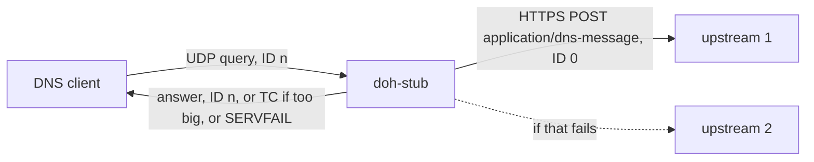

# doh-stub

A small DNS-over-HTTPS stub for setups that used `cloudflared proxy-dns`. Cloudflare removed
that command in cloudflared 2026.2.0.

doh-stub takes plain DNS queries on a local port and forwards each one to a DoH server
(RFC 8484). It takes the same `--address`, `--port` and `--upstream` flags, with the same
default upstreams.

## Quick start

```sh
cargo install --git https://github.com/Urthella/doh-stub
doh-stub --port 5053
dig @127.0.0.1 -p 5053 example.com
```

With Pi-hole, set the custom upstream DNS server to `127.0.0.1#5053`, as the old cloudflared
guide did.

| Flag | Default | |
|---|---|---|
| `--address` | `127.0.0.1` | Where to listen. |
| `--port` | `53` | `0` picks a free port, which the startup line prints. |
| `--upstream` | `https://1.1.1.1/dns-query`, `https://1.0.0.1/dns-query` | Repeat for more servers. They are tried in order. |

cloudflared's `--bootstrap`, `--metrics` and `--max-upstream-conns` aren't supported.

## What it does



- **Each query** is POSTed as `application/dns-message`. Its ID is set to 0 first, as RFC 8484
  §4.1 asks, so the same question always makes the same HTTP request. The client's ID goes
  back on the answer.
- **Upstreams** are tried in order. One that fails, times out after 4 s, or answers with
  something too short to be DNS is skipped. If every upstream fails, the client gets SERVFAIL
  at once instead of waiting out its own timeout.
- **Answers too big for the client's UDP size** are cut down to the question, with TC set. The
  client's UDP size is the one in its EDNS(0) record, or 512 bytes if it has none. TC tells
  the client to ask again over TCP. This version doesn't listen on TCP yet.
- **No cache.** Pi-hole and most clients cache already.
- **TLS comes from the operating system:** SChannel on Windows, OpenSSL on Linux, and the
  Security framework on macOS. No crypto is bundled.
- **The default upstreams are IP addresses**, so the stub never needs DNS to find them. If you
  give a URL with a hostname, the system resolver looks it up. In that case, don't make
  doh-stub the system's only resolver.

## How it's checked

- **The real binary against a fake DoH server.** Every message in these tests is built and
  read with [hickory-proto](https://crates.io/crates/hickory-proto), an independent DNS
  implementation. The tests check:
  - the upstream gets a POST with the right content type and ID 0;
  - the client gets its own ID back;
  - an HTTP 500 or a garbled reply moves on to the next upstream;
  - SERVFAIL comes back when every upstream fails, keeping the question and RD;
  - a 4 kB answer is cut for clients with no EDNS, with 1232 and with 100, but not with 8192;
  - packets that aren't queries get no reply.
- **The parser.**
  - The EDNS size is found behind records whose names are compressed.
  - 20,000 damaged messages pass through it without a panic.
- **Mutation testing.** Fifteen deliberate bugs were planted one at a time, and the tests caught
  every one. The bugs included:
  - the ID not reset or not restored;
  - no failover;
  - a pointer read as one byte;
  - TC not set;
  - SERVFAIL sent as NOERROR.
- **A live run against Cloudflare**, on Windows with SChannel:
  - An A query was answered in 180 ms.
  - `google.com TXT` without EDNS came back as a 28-byte reply with TC set.
  - The same query with EDNS 4096 got all 17 answers in 1187 bytes.

## Limits

- At most 16 queries are in flight at once, from a fixed pool of workers. That is plenty for a
  home network or a Pi-hole.
- It uses HTTP/1.1 with keep-alive, not HTTP/2.

## Develop

```sh
cargo test
```

Or `nix develop` for the pinned toolchain. On Linux the build needs OpenSSL's headers
(`libssl-dev`).

## License

MIT
